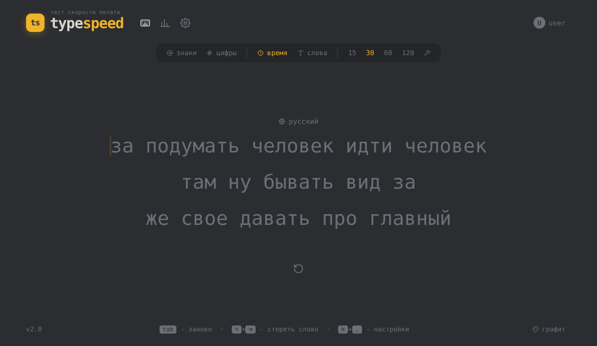

# TypeSpeed

Тест скорости печати для macOS (нативное окно на Swift + WKWebView).

A minimal Monkeytype-style typing test packed into a native macOS app: a Swift window around a single-page UI.

- режимы «время» (15 / 30 / 60 / 120 с или свое значение) и «слова», знаки препинания и цифры по желанию
- русский и английский, словари на 200 / 1k / 2k самых частых слов
- профиль со статистикой всех тестов: рекорды, средние, график, история
- настройки как в Monkeytype: сложность (эксперт / мастер), стоп на ошибке, уверенный и слепой режимы, ленивый режим (ё = е), звуки нажатий, вид и плавность каретки, каретка-соперник, шрифт, слов в строке, строк на экране
- 12 цветовых тем
- `tab` / `esc` - заново, `⌥ + ⌫` - стереть слово, `⌘ ,` - настройки, `⌘ 1/2/3` - тест / профиль / настройки

## Сборка

    bash build.sh            # собрать и запустить build/TypeSpeed.app
    bash build.sh install    # собрать и положить в /Applications

Нужны Command Line Tools (`xcode-select --install`), Xcode не обязателен.

## Структура

- `Sources/main.swift` - окно, меню, сохранение данных в `~/Library/Application Support/TypeSpeed`, синхронизация цвета заголовка с темой
- `Resources/index.html` - весь интерфейс и логика теста (можно открыть и в браузере)
- `Resources/words.js` - словари
- `Resources/AppIcon.icns` - иконка
